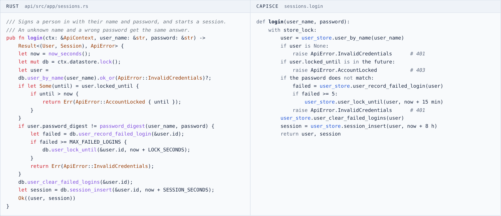
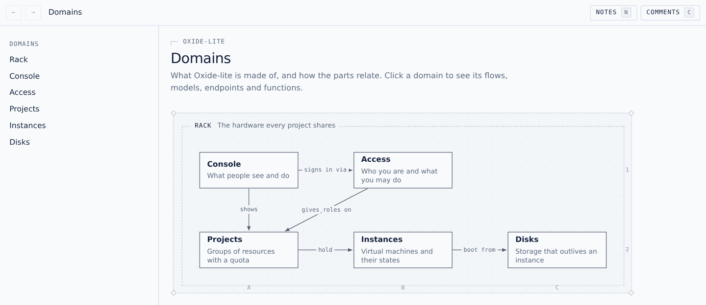
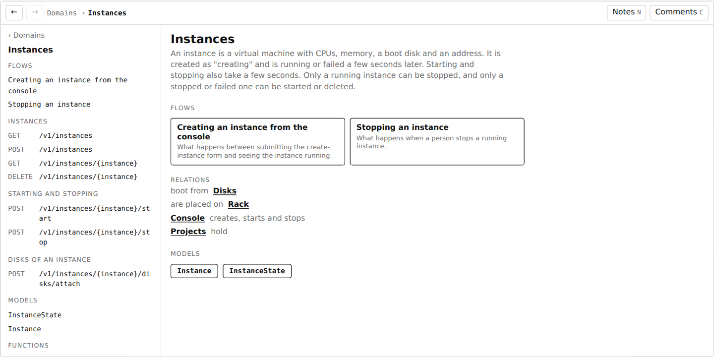
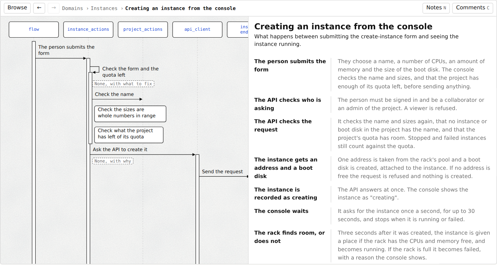
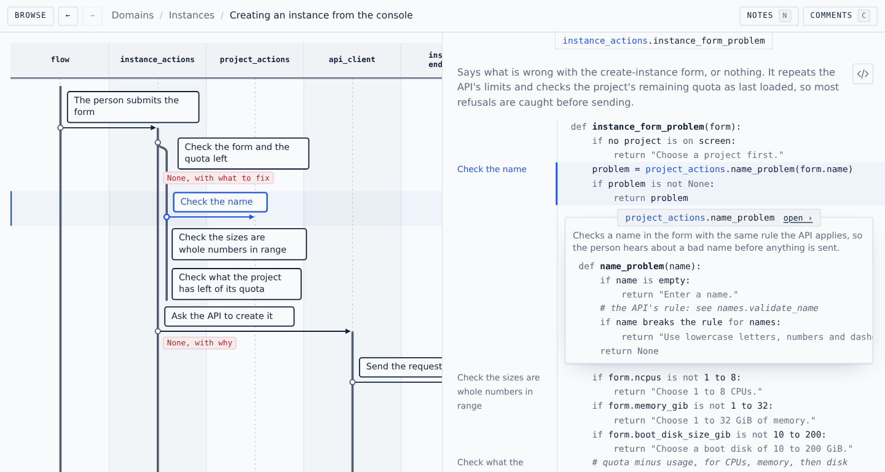
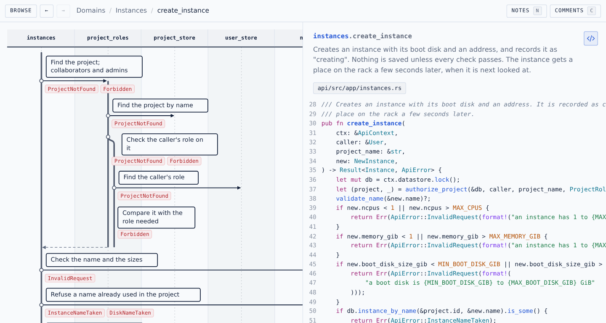
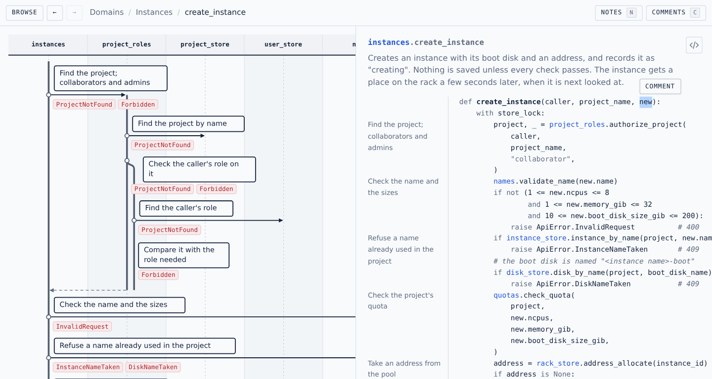
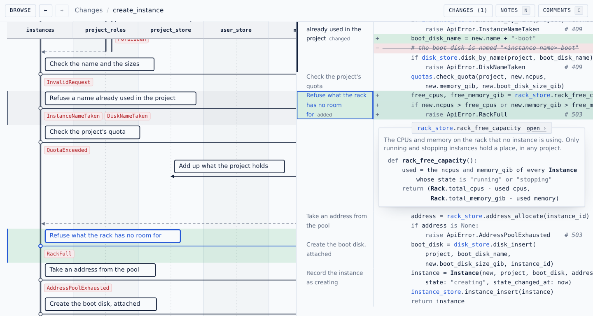
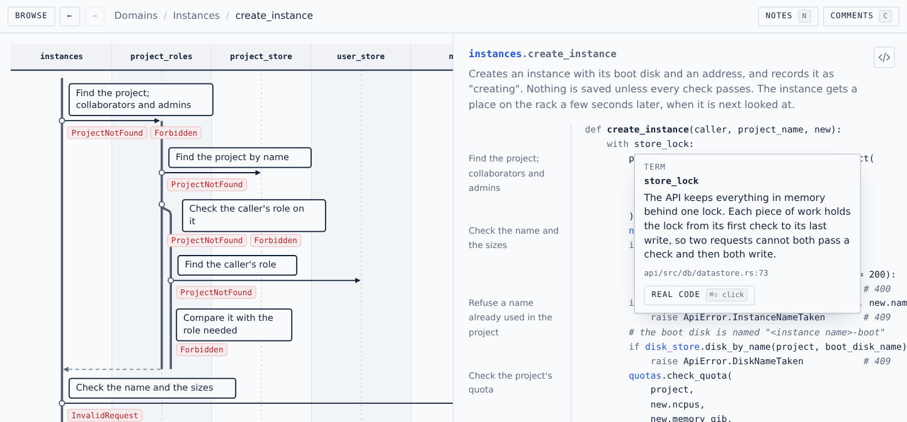

# Capisce

[Capisce]([url](https://capisce.software/)) is an open source tool that helps you understand a codebase.

As your agents iterate on your codebase, they also write the core business logic in pseudo-code. This pseudo-code helps you see a compressed form of your codebase, removing boilerplate.



**Zooming in, zooming out**

Capisce helps you understand a codebase at different levels of resolution.

We start at your high-level domains.



Clicking on a domain opens up the core user stories within that domain.



Clicking a user story shows us a diagram that traces through the entire program. We also see pseudo-code of the high-level user story.



We can click a step in the flow diagram and see the code at that level.



The pseudo-code is derived directly from the actual code, which we can toggle in the upper right.



**Comments**

This surface is interactive. You can leave your agents notes by highlighting…



… or by using the comment box (toggleable by <kbd>c</kbd>).


**Diffs**

Capisce’s pseudo-code is saved alongside your codebase in a `.capisce/` folder. This allows Capisce to show you a diff of your feature branch against main.



**Glossary**

You can keep definitions of common domain models in Capisce.



**Skills**

Capisce includes skills so that your agents will automatically maintain the pseudo-code reflection of your codebase.

```sh
npx skills add kierangilliam/capisce
```

- `/capisce:setup` This builds Capisce’s state on a new codebase. To be used once during setup.
- `/capisce:update` This updates Capisce’s state by writing pseudo-code and updating the glossary for new code changes.
- `/capisce:address-comments` An agent will pull your comments and address them, either replying to your comment or making a change to your codebase.

**Examples**

*Oxide-lite*: This is meant to be a replication of Oxide’s Rust control plane interacting with a TypeScript frontend. I say “meant to be” because I gave boot to an agent to transpose Oxide’s codebase into this simplified form, but I will not pretend to be smart enough to claim it’s entirely correct. All that to say, any crimes against Oxide’s good taste or architectural intent were committed by the agent. I maintain plausible deniability. ([code](examples/oxide-lite)) ([demo](https://capisce.software/demo/oxide-lite/))

*Help desk*: A help desk built in Go. ([code](examples/help-desk)) ([demo](https://capisce.software/demo/help-desk/))

**Reference**

The commands, the config file, the map format, comments, timings and installing the skills are in [docs/reference.md](docs/reference.md). The same page with moving pictures is at [capisce.software](https://capisce.software).
